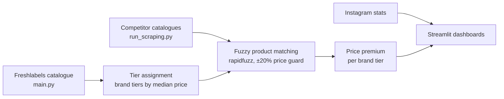

# Freshlabels Competitive Pricing & Brand Analysis

The data pipeline behind a consulting case: it scrapes an e-shop and its competitors, matches products across shops, measures price premium by brand tier, and shows the results in Streamlit dashboards.

## Context
**EY-Parthenon Management Consulting Challenge 2026**, client case: **Freshlabels** (Czech fashion e-commerce). Team of two. The team reached the **top 5 of 50 teams** and presented its recommendations to senior EY and Freshlabels representatives (final deck: April 2026).

This repository contains the data and analytics part of the work. Strategy, financial modelling and the final deck are not included.

## Problem
How strong is Freshlabels' brand, and where does it stand on price against competing e-shops? The answer was meant to inform growth, discount and marketing recommendations.

## Analyses performed (whole team)
- Business diagnosis
- Customer segmentation using LTV/CAC
- A 36-month cohort model
- Discount-cost analysis
- A competitive benchmark: share of search, social engagement and the price comparison from this repo
- Brand-equity valuation (NPV) with ROI and payback
- A 12-month roadmap with a KPI dashboard

## Approach (this repository)



- **Scraping:** a polite scraper with delays, jitter and retries for the Freshlabels catalogue (`scraper/`). Playwright-based scrapers cover three competitors (`scrapers/`). Instagram post and collaborator stats were collected semi-manually.
- **Tiering:** brands are grouped into tiers by median product price (`analysis/tier_assignment.py`).
- **Matching:** names are normalised and matched with `rapidfuzz` token-set ratio. Matches are HIGH (≥ 90) or MEDIUM (80–89), and a pair is rejected when prices differ by more than 20% (`analysis/matcher.py`).
- **Price premium** per brand tier and competitor (`analysis/price_premium.py`), shown in Streamlit/Plotly dashboards.

## Results
- Top 5 of 50 teams in the challenge.
- Match coverage varied widely between competitors, from about 2% to 30% of the catalogue (`data/analysis/match_rate_report.csv`), so the price-premium comparison is strongest for the competitor with the best overlap. The matching was not validated against hand-labelled pairs.

## Tech stack
Python 3.11, requests, BeautifulSoup/lxml, Playwright, pandas, rapidfuzz, Plotly, Streamlit.

## How to run
```bash
pip install -r requirements.txt
playwright install chromium                    # needed by the competitor scrapers
python main.py --dry-run                       # Freshlabels catalogue (see --help for options)
python run_scraping.py --competitors queens    # competitor catalogues
python run_analysis.py                         # tiers → matching → price premium
streamlit run dashboard_extended.py
```
`deep_translator` and `pytrends` (used by helper scripts) are not in `requirements.txt` yet.

## Repository structure
```
main.py                  # Freshlabels scraper entry point
run_scraping.py          # competitor scraping orchestrator
run_analysis.py          # analysis pipeline orchestrator
scraper/                 # Freshlabels scraper (HTTP client, parsers, models)
scrapers/                # competitor scrapers (base class + one per shop)
analysis/                # tier assignment, matching, price premium
dashboard*.py, dashboard/ # Streamlit dashboards
estimate_traffic.py      # web-traffic estimate helper
```

## Team
- **Dmytro Khursenko**: data scraping, product matching, price analysis and dashboards (this repository)
- **Filip Cvrkal**: strategy and the final presentation

Thanks to EY-Parthenon and Freshlabels for the case.
